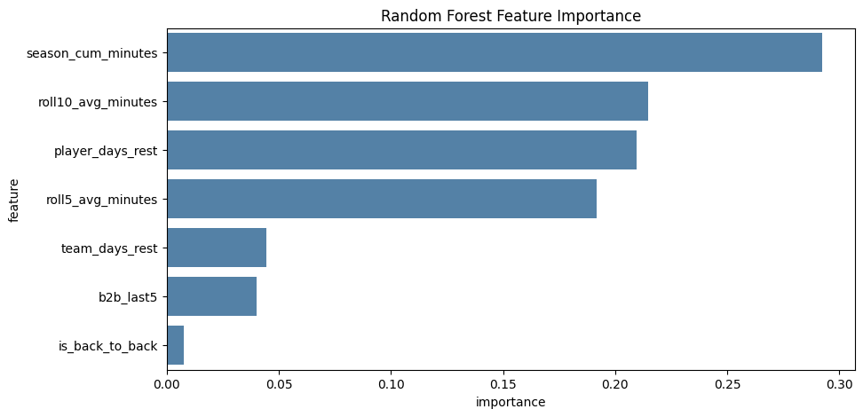
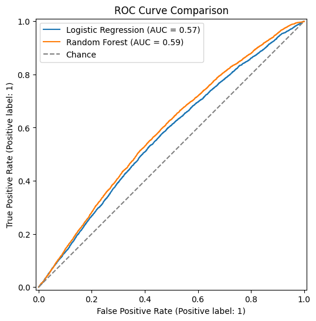

# Predicting NBA Player Injury Risk from In-Season Workload

**Can a player's recent workload warn teams that an injury is coming?** NBA teams invest heavily in load management, but the league's own analytics group has reported finding no meaningful link between schedule density and injury. This project tests that question independently, building machine learning models that predict whether a player will be placed on the injured list within the next 7 days based only on workload information known before each game.

📓 [View the notebook](nba_injury_risk_model.ipynb) · 📄 [Read the white paper (PDF)](nba_injury_risk_white_paper.pdf) · 📊 [View the slides (PDF)](nba_injury_risk_presentation.pdf)

---

## Key Findings

- **Workload carries a real but weak signal.** The best model, a Random Forest, reached a ROC-AUC of 0.59 on two unseen seasons. That's better than chance (0.50) but well below the roughly 0.70 usually considered useful for flagging individual players.
- **It catches most injuries, at the cost of many false alarms.** The Random Forest flagged 59% of games that preceded an injury, but only about 1 in 9 flags was followed by an actual injury.
- **Cumulative minutes and rest matter most; back-to-backs barely matter.** Season-to-date minutes, 10-game average minutes, and days of rest were the strongest predictors. Back-to-back games contributed almost nothing.
- **The results support the NBA's own conclusion.** Using different data and methods, this analysis also found little direct link between schedule density and injury, suggesting that workload alone is an incomplete picture of injury risk.

| Metric (injury class, test set) | Logistic Regression | Random Forest |
|---------------------------------|---------------------|---------------|
| Recall | 0.48 | **0.59** |
| Precision | 0.11 | 0.11 |
| F1-score | 0.18 | **0.19** |
| ROC-AUC | 0.569 | **0.587** |

## Research Questions

1. Can recent workload (rolling minutes, rest, back-to-backs, cumulative minutes) predict injury in the games that follow?
2. Which workload features are the strongest predictors?
3. Do the findings support or contradict the NBA's conclusion that schedule density isn't meaningfully linked to injury?

## Data

| Dataset | Description |
|---------|-------------|
| [NBA Injuries 2010–2020](https://www.kaggle.com/datasets/ghopkins/nba-injuries-2010-2018) | 27,105 injured-list transactions from Pro Sports Transactions, with free-text notes |
| [NBA Games](https://www.kaggle.com/datasets/nathanlauga/nba-games) | 26,651 games (2003–2022) with dates and seasons |
| [NBA Games Details](https://www.kaggle.com/datasets/nathanlauga/nba-games) | 668,628 player box scores, one row per player per game |

## Approach

1. **Building a reliable injury label from free text.** Of 17,560 injured-list placements, 620 were rest days, personal leave, or conditioning rather than injuries; 14 were coaches' medical leaves logged as players; and one recorded a team name as the player. Removing these left 16,935 genuine injury events.
2. **Matching players across sources.** Normalizing names (e.g., "C.J." to "CJ," dropping "Jr.") raised the match rate between injury records and box scores from 94.3% to 97.0%.
3. **Engineering workload features without leakage.** For each player-game, features were computed using only prior games: 5- and 10-game average minutes, days of rest, season-to-date minutes, and team back-to-back patterns.
4. **Defining the target.** Each game was labeled 1 if the player's next injury occurred within 7 days, giving an 8.3% positive rate across 284,921 player-games from 2010 to 2019.
5. **Modeling.** Trained logistic regression and Random Forest models with balanced class weights on the 2010–2017 seasons and tested on 2018–2019, so the models were always evaluated on games that happened after their training data.
6. **Diagnosing multicollinearity.** Two rolling-minutes features were 0.99 correlated, which caused unstable logistic regression coefficients until one was removed.

## Ethical Considerations

A "high risk" flag could affect a player's playing time, trade value, or contract if misused, so this model should only ever be one supplementary input for medical staff, never a basis for personnel decisions. Because cumulative minutes was the top feature, heavy-minutes players may be flagged more often because of their role rather than true risk, so any deployment would need an audit of flag rates across positions and roles.

## Next Steps

- Add prior injury history, one of the best-established risk factors, along with age, position, and experience
- Test other prediction windows (3, 5, 10, and 14 days)
- Try gradient-boosting models with time-series-aware cross-validation
- Separate injury types, since an ankle sprain and an ACL tear likely relate to workload differently

## Tools

Python · pandas · NumPy · scikit-learn · matplotlib · seaborn · Jupyter

---

*Completed October 2026 for DSC 680 (Applied Data Science).*
